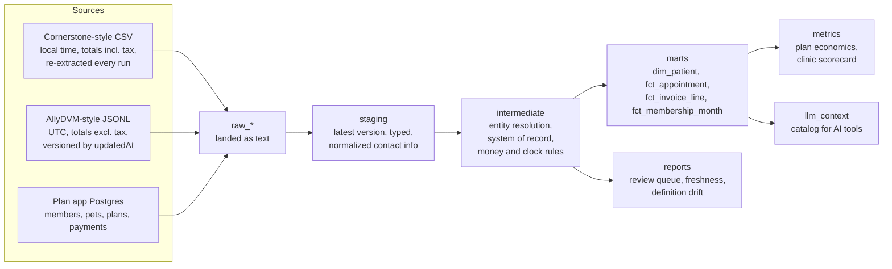

# vet-pims-reconciler

[](https://github.com/manishreddy998/vet-pims-reconciler/actions/workflows/build.yml)

**One trustworthy definition of "appointment", "invoice" and "patient" across veterinary practice-management systems.**

A wellness-plan company ingests data from many clinics. Each clinic runs a practice-management system (PIMS), and each PIMS describes the same visit in its own shape: different IDs, clocks, status codes, tax rules and item codes. Clinics switch systems. Feeds stop. Pet owners spell things differently in your app than at the front desk. Ask three teams how many visits happened last month and you get three numbers.

This repo is a small, working version of the fix: a dbt project that reconciles two PIMS (a Cornerstone-style CSV export and an AllyDVM-style API dump) with the plan app's Postgres data into conformed, tested, documented models, plus a review queue for everything it could not resolve and a catalog that internal AI tools can use safely.

The data is synthetic and generated by `scripts/generate.py`. The export shapes are illustrative, not vendor schemas.

```bash
make setup && make all        # about 30 seconds: generate data, load, build, 96 tests, docs, report
open reports/reconciliation_report.html
```

## The problem in one table

How many visits happened each month? The same warehouse gives four answers:

| Month | Rows in the export files | Every appointment, any status | "Completed" in both systems, added up | **Canonical visits** |
|---|---:|---:|---:|---:|
| Mar 2026 | 3,650 | 923 | 755 | **700** |
| Apr 2026 | 3,348 | 892 | 733 | **636** |
| May 2026 | 3,859 | 1,003 | 815 | **699** |

In the months before Maple Grove switched from Cornerstone to AllyDVM, the new system imported history the old system still owns. Adding both systems overcounts visits by up to **17%**. Raw export rows overcount by more than **5x**, because every extract re-sends every appointment. (`reports.rpt_definition_drift`)

## What it does



| Problem in the data | How it is handled | Where |
|---|---|---|
| The same appointment is exported many times with changing status | Keep the latest version per source key. Keep the version count | `stg_*__appointments` |
| One PIMS uses clinic local time, the other UTC | Everything gets both `start_utc` and `start_local`. Daily and monthly counts use the clinic's clock | `int_appointments`, `macros/portable.sql` |
| A clinic switched PIMS mid-year, so history exists twice | A clinic-to-PIMS link table with active dates decides the **system of record per clinic per date**. The rest is excluded with a reason | `int_appointments.excluded_reason` |
| Bookings left behind in the old PIMS after the switch | Excluded as `orphaned_after_pims_migration`, listed for review | `rpt_reconciliation_issues` |
| Appointments still "booked" days after their start time | Resolved to `unresolved` rather than counted as visits | `int_appointments.resolved_status` |
| Status vocabularies differ (`C`/`N`/`X` vs `Completed`/`NoShow`) | One mapping seed. An unmapped status fails a test | `seeds/appointment_status_map.csv` |
| One PIMS reports totals with tax, the other without | One money definition (net, tax, gross). Invoices whose math does not add up are flagged | `int_invoices` |
| Item codes differ per PIMS, and new codes appear | A service catalog maps codes to canonical services. Unmapped codes go to the queue | `seeds/service_catalog.csv` |
| App pets and PIMS patients are spelled differently | Ranked, explainable matching rules with confidence (email + pet name 0.99 down to other-clinic match 0.75) | `int_patient_matches` |
| The same animal has a record in both PIMS after a migration | Migration twins are linked, so the animal keeps one `golden_patient_id` | `int_patient_xref` |
| A clinic feed silently stops | Hours since last update per practice feed. A test warns on every build | `rpt_feed_freshness` |
| Plans cover services with yearly limits | Coverage is computed per membership year, so the second dental cleaning is not "covered" | `fct_invoice_line.is_plan_covered` |

## Results on the default dataset

From a run on Nov 14, 2026. The generator is seeded but dates are relative to the run date, so exact counts shift slightly.

- **103,000+ raw rows** from 3 sources become **3,473 real animals** (from 3,941 PIMS patient records and 1,596 app pets).
- **96.9%** of plan pets matched to a clinic record. The other 50 are enrolled but never registered at the clinic, and are listed in the queue.
- **765 review items**, by severity: 106 high (e.g. 16 active memberships billing for pets the PIMS marks deceased, 39 pets registered at a different clinic than the app says), 228 medium, 112 low, 319 info.
- **96 dbt tests pass.** The 1 warning is deliberate: one AllyDVM feed was made to stop 3 days ago, and the build catches it.
- The same project runs on **DuckDB and Postgres** with identical results (same animal count, visit count, issue count and revenue to the cent). GitHub Actions runs both on every push.
- At 10x scale (about 1M raw rows) the full dbt build takes 13 seconds on a laptop.

## For the AI tools

`llm_context/catalog.md` and `catalog.json` are generated from dbt's own manifest on every build. They give an internal LLM tool only the approved tables, the grain of each, column meanings, a business glossary ("a visit is...", "count animals with golden_patient_id"), rules (read-only, never query raw or staging), and vetted SQL for common questions. Every vetted query is executed during export, so a broken one fails the build.

## Run it

```bash
make setup            # python venv + dbt-duckdb
make all              # generate -> load -> dbt build -> docs + AI catalog -> HTML report
make all SCALE=10     # ten times the data
```

On Postgres:

```bash
export PGHOST=... PGUSER=... PGPASSWORD=... PGDATABASE=analytics DBT_TARGET=postgres DBT_PROFILES_DIR=.
pip install dbt-postgres
python scripts/generate.py && python scripts/load.py --target postgres
dbt seed && dbt build
```

## Layout

```
scripts/        generate.py (messy synthetic data), load.py (land as text), export_llm_catalog.py, report.py
models/staging/       one view per source table: latest version, typed, normalized
models/intermediate/  entity resolution, system of record, clock and money rules
models/marts/         dim_*, fct_*, fct_membership_month, metrics views
models/reports/       review queue, feed freshness, definition drift
seeds/          status map, service catalog, plan coverage
tests/          singular tests (no double-counted visits, match rate, invoice math)
docs/           options_memo.md: where the warehouse should live, with costs and triggers
```

## Decisions worth arguing about

- **System of record by date, not "newest wins".** Imported history in the new PIMS is a copy. The old system stays the truth for dates before the switch.
- **Rules before machine learning for matching.** Every link has a named rule and a confidence, so an ops person can see why two records were joined. A model can come later, trained on the review queue's decisions.
- **Exclude with a reason, never delete.** Every record that is left out of a fact table appears in `rpt_reconciliation_issues` with why.
- **Postgres first.** See `docs/options_memo.md`: the trust problem is definitions, not engine speed. The memo lists the triggers for moving to a cloud warehouse.

---

Built by Manish Reddy, Data/AI Engineer in Toronto. [LinkedIn](https://www.linkedin.com/in/manish-re-50c02a719k/) · [GitHub](https://github.com/manishreddy998)
